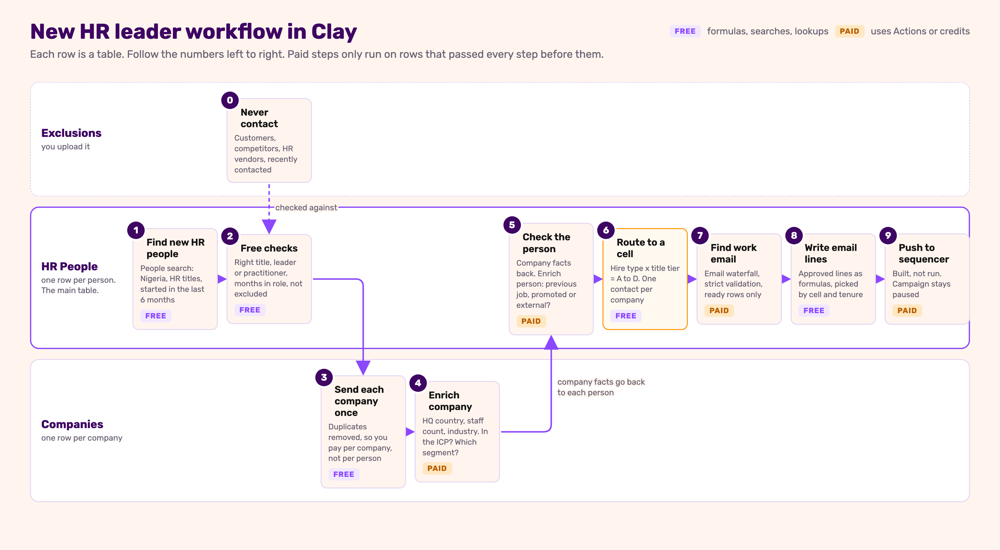

# Clay Build Guide: New HR or People leader, last 180 days (PaidHR)

A step-by-step guide to building `workflow-spec.md` (in this folder) in Clay. Written for someone who has never built anything in Clay. Follow the parts in order. Each step tells you **why** it exists, **what to click**, **what to type**, **how to check it worked** and **what it costs**.

> **Don't skip the checks.** The most common Clay mistake is running a column on 500 rows before checking it worked on 1. Every step below ends with a check. If the check fails, fix it before moving on.

---

## Contents

- [What you are building](#what-you-are-building)
- [Clay words you need](#clay-words-you-need)
- [Before you start](#before-you-start)
- [Part 0. Set up the workbook](#part-0-set-up-the-workbook)
- [Part 1. Exclusions table](#part-1-exclusions-table)
- [Part 2. Find the new HR people](#part-2-find-the-new-hr-people)
- [Part 3. Free gates on each person](#part-3-free-gates-on-each-person)
- [Part 4. Companies table](#part-4-companies-table)
- [Part 5. Bring company facts back to each person](#part-5-bring-company-facts-back-to-each-person)
- [Part 6. Check the person](#part-6-check-the-person)
- [Part 7. Route each person to a cell](#part-7-route-each-person-to-a-cell)
- [Part 8. Find and verify the work email](#part-8-find-and-verify-the-work-email)
- [Part 9. Write the email lines](#part-9-write-the-email-lines)
- [Part 10. Views for the operator](#part-10-views-for-the-operator)
- [Part 11. Connect the sequencer (build it, don't run it)](#part-11-connect-the-sequencer)
- [What it costs](#what-it-costs)
- [Final checklist](#final-checklist)
- [When something goes wrong](#when-something-goes-wrong)
- [Things the spec needs to fix](#things-the-spec-needs-to-fix)

---

## What you are building

The spec says: find people in Nigeria who started an HR or People role in the last 180 days, at a company with 20 to 200 staff in logistics, manufacturing, retail or tech. Check whether they were **promoted from inside** or **joined from outside**, and whether they are a **leader** (Manager, Head, Lead, Director, Chief) or a **practitioner** (HR Officer, HR Generalist). Those two answers put each person in one of 4 cells (A to D). Then find their email and write the approved 3-email sequence for their cell.

You will build **3 tables** inside **1 workbook**:



Each row of the picture is a table. The numbers are the order you build in. Step 0 is the list you upload first.

Why this shape:
- **People first**, because the trigger is something that happened to a person (they started a new HR role).
- **Company checks happen once per company** in their own table. If 3 HR people at one company show up, you pay to enrich that company once, not three times.
- **Everything paid runs last**, and only on rows that passed every free check before it.

What a finished row in **HR People** looks like, reading left to right (made-up example):

| Person | Title | Company | Started | Tier | Tenure | Hire type | Cell | Ready? | Email | E1 L1 … E3 CTA |
|---|---|---|---|---|---|---|---|---|---|---|
| Amaka O. | HR Manager | Ikeja Freight | 2026-09 | leader | new | external | A | Yes | amaka@ikejafreight… | Still new to running HR at Ikeja Freight, … |

---

## Clay words you need

| Word | What it means |
|---|---|
| **Workbook** | A folder of tables for one campaign. |
| **Table** | A spreadsheet. One row per company or per person. |
| **Source** | Where a table's rows come from (a Clay search, a CSV, another table). |
| **Column** | One piece of information per row. Three kinds matter: **plain** (you type or import it), **formula** (Clay calculates it, free), **enrichment / action** (Clay calls a data provider or AI, usually costs). |
| **Formula** | A small calculation, like a spreadsheet formula. Free. Clay has an AI helper: describe what you want in plain English and it writes the formula for you. |
| **Enrichment** | A column that looks something up (company size, a person's past jobs, an email). Costs **Actions**, and sometimes **Data Credits**. |
| **Lookup** | A column that reads a matching row from another table in your workbook. Free. |
| **Send table data** | A column that copies rows from this table into another table. Free. |
| **Run condition** ("Only run if") | A rule on a paid column: it only runs on rows where the rule is true. This is how you avoid paying for rows you'll throw away. |
| **Auto-run** | When on, new columns run on every row by themselves. **Keep it off** while building. |
| **Actions** | Clay's main usage meter. About 1 Action per enrichment per row. Unused Actions expire monthly. |
| **Data Credits** | A second meter, used when Clay pays a data provider for you (for example, email finders). |
| **View** | A saved filter on a table, like "only rows ready to send". |
| **Cell** (in this guide) | One of the spec's 4 routing groups, A to D. Not a spreadsheet cell. When this guide means a spreadsheet cell it says "the cell in column X". |

---

## Before you start

Tick these off **before** you build.

- [ ] **Clay account** with access to the workspace you'll build in. Note which plan it's on (Settings → Plans & billing). You need enough Actions for roughly: number of companies + number of people + email lookups. See [What it costs](#what-it-costs).
- [ ] **Email finder connections** (Settings → Connections), if you'll use your own provider keys. Without your own keys, Clay uses its own and charges Data Credits.
- [ ] **The spec is open** next to you: `output/campaigns/new-hr-leader-180-days/workflow-spec.md`. Sections 2 (who's in and out), 4 (signals), 5 (cells), 6 (variables) and Copy are what you're building.
- [ ] **The Exclusions CSV** is ready (Part 1 shows exactly what goes in it).
- [ ] **Test size: 25 people** for the first import. You can import more later.

---

## Part 0. Set up the workbook

**Why:** one place for everything in this campaign, so anyone can find it and follow it.

1. In Clay, click **+ New** (top left) → **Workbook**.
2. Name it: `PaidHR · New HR or People leader (180 days)`.
3. In the workbook description, paste: *"Signal: HR or People leaders and practitioners at Nigerian companies (20 to 200 staff, logistics, manufacturing, retail, tech) who started the role in the last 180 days. Routes: hire type (external or promoted) x title tier (leader or practitioner) = cells A to D. Spec: output/campaigns/new-hr-leader-180-days/workflow-spec.md. Not sendable yet."*

**Check:** the workbook appears in your Clay home with that name.
**Cost:** free.

---

## Part 1. Exclusions table

**Why:** the spec (section 2, Exclude) lists companies we must never email: PaidHR's own customers, competitors and HR or payroll vendors, open pipeline, and any company another PaidHR workflow contacted in the last 100 days. We put them in one table so every other table can check against it.

### 1.1 Make the CSV

Create a spreadsheet with **3 columns** and save it as `exclusions.csv`. These rows come from the spec's Exclude list. Domains are left blank on purpose: don't guess them.

| Company Name | Domain | Type |
|---|---|---|
| FAMASI | | Customer |
| Heroshe | | Customer |
| Flutterwave | | Customer |
| Mono | | Customer |
| Risevest | | Customer |
| GetEquity | | Customer |
| Kredete | | Customer |
| GO54 | | Customer |
| Mira | | Customer |
| AEC | | Customer |
| NOI Polls | | Customer |
| Sygnite | | Customer |
| ReelFruit | | Customer |
| SeamlessHR | | Competitor |
| Workpay | | Competitor |
| SoftSUITE | | Competitor |
| Bento Africa | | Competitor |
| Sage | | Competitor |
| PaySpace | | Competitor |
| Cadana | | Competitor |
| Deel | | Competitor |

**Fill in every Domain** before uploading. Type it plain, the way Clay shows domains: `flutterwave.com`. No `https://`, no `www.`, no slash at the end. Find each one on the company's LinkedIn page or website, and check it's the company's own site, not a product or country page. For "Sage", use the domain of Sage's Nigerian or African business if you can find one; otherwise the main one.

> **Why domain and not name:** names clash. "Mono", "Mira" and "AEC" are also names of unrelated companies, and the same company can appear as "Heroshe" or "Heroshe Inc". A domain belongs to one company.

Two more groups go in this same CSV when you have them (spec "Open items before launch"):
- **Type = Customer** and **Type = Pipeline:** PaidHR's full customer list and open deals, from a CRM export. **TBD.**
- **Type = Recently contacted:** every company domain any PaidHR sequence (including `payroll-hr-role-posted`) contacted in the last 100 days. Export it from the sequencer before each monthly run. **TBD.**

### 1.2 Upload it

1. Inside the workbook, click **+ Add table** → **Import CSV**.
2. Upload `exclusions.csv`. Name the table `Exclusions`.
3. Change the `Domain` column's data type to **URL** (column header → Edit column → Data type).

**Check:** 21 rows (more once the CRM and sequencer lists are added), 3 columns, no blank Domain.
**Cost:** free.

---

## Part 2. Find the new HR people

**Why:** this is the trigger (spec section 1, signals 1, 4 and 5). Clay's people search can filter by job title, country, company size, industry **and when they started the job**, all in one search. Searching and importing is **free**. You only pay later when you enrich.

### 2.1 Start a people search

1. In the workbook, click **+ Add table** → **Find people**.
2. You'll see a filter panel on the left and a preview of matching people on the right.

### 2.2 Set the filters

Fill in each filter exactly as below. These come straight from spec section 2.

| Filter | Set it to | Why |
|---|---|---|
| **Job title: include** (current job) | HR Manager · Human Resources Manager · Head of HR · Head of Human Resources · HR Lead · HR Director · HR & Admin Manager · Head of People · People Lead · People & Culture Manager · People & Culture Lead · People Operations Manager · People Operations Lead · Chief People Officer · Chief Human Resources Officer · CHRO · HR Officer · Senior HR Officer · HR Generalist | The spec's trigger titles, leaders and practitioners |
| **Job title: exclude** | Assistant · Intern · Recruit · Talent | Spec excludes HR Assistant, HR Intern, Recruiter, Talent Acquisition. Don't exclude "Officer": HR Officer and Chief People Officer are both in |
| **Person location: country** | Nigeria | Spec section 2: Nigeria only |
| **Company size** | 11-50 · 51-200 | The spec says 20 to 200. Clay's size buckets go 11-50, 51-200, so the floor of 20 is checked later with a formula (Part 4.4) |
| **Company industry: exclude** | Staffing and Recruiting · Human Resources Services · Government Administration | Recruiters, HR outsourcing firms and public sector are out (spec section 2) |
| **Started current role** (may be called "Time in current role" or "Job start date") | Within the last **6 months** | The trigger. Start dates come as year and month, so "180 days" becomes "6 months or less". If your panel doesn't show this filter, skip it: Part 3 has a free formula that does the same job |

### 2.3 Check the numbers before importing

Look at the **total count** above the preview. Write it down. Then remove the three practitioner titles (HR Officer, Senior HR Officer, HR Generalist) and write the count down again. Put them back afterwards.

| Search | Count |
|---|---|
| All titles | ___ |
| Leader titles only | ___ |
| Practitioners (first minus second) | ___ |

**Why this matters:** the spec's real volume is TBD (spec section 1). This preview is the free volume check. LinkedIn data for Nigerian companies with 20 to 200 staff is thin, so expect lower numbers than you'd guess. Record the numbers in the spec when you have them.

### 2.4 Import

1. Set the import **limit to 25** for the first test.
2. Click **Import** (or **Save to table**). Name the table `HR People`.
3. **Turn Auto-run OFF**: open the table's settings (the ⚙ or "…" menu at the top of the table) → find **Auto-update / Auto-run** → off. Do this before adding any column.

### 2.5 Add the hidden fields

The search knows each person's **company domain** (e.g. `acme.com`), **company LinkedIn URL** and the **month they started** (e.g. `2026-08`), but doesn't always show them as columns.

1. Click any cell in the first column (the search source column). A panel opens showing everything the search returned for that person.
2. Find the company domain (inside the matched job, under company → domain). Click it → **Add as column**. Rename the column `Company Domain`.
3. Find the company LinkedIn URL (same place, often `linkedin_url` or `url` under company). **Add as column**. Rename it `Company LinkedIn`.
4. Find the start date (inside the matched job → start_date). **Add as column**. Rename it `Start Date`.
5. Change `Company Domain` and `Company LinkedIn` to type **URL** (column header → Edit column → Data type).

### 2.6 Remove duplicates

Table settings → **Deduplicate** → choose `LinkedIn Profile`. If one person appears twice, Clay keeps one.

**Check:** 25 rows. Each row has a name, job title, company, LinkedIn Profile, Company Domain, Company LinkedIn and Start Date. Open 3 LinkedIn profiles and confirm they really are HR people at Nigerian companies who started in the last 6 months.
**Cost:** free.

---

## Part 3. Free gates on each person

**Why:** drop the rows we know are wrong **before** spending anything, and work out the two free answers the copy needs (title tier and tenure stage). All columns here are formulas or lookups (free).

**How to add a formula column:** click **+ Add column** (right end of the table) → **Formula**. You can type the formula, or click **Use AI** inside the formula box and describe it in plain English. When the formula refers to another column, type `/` and pick the column from the list. Below, columns are written as `{{Column Name}}`.

### 3.1 Title and tenure formulas

| Column | Plain English for the AI helper | Formula |
|---|---|---|
| `Title Match?` | True if the job title is one of the spec's HR or People titles and does not contain assistant, intern, recruit or talent | see below |
| `Title Tier` | "practitioner" if the title contains officer or generalist but not chief; otherwise "leader" | `(/officer\|generalist/i.test({{Job Title}} \|\| "") && !/chief/i.test({{Job Title}} \|\| "")) ? "practitioner" : "leader"` |
| `Months in Role` | Number of whole months between Start Date (format YYYY-MM) and today. Blank if Start Date is blank | see below |
| `Tenure Stage` | "new" if Months in Role is 3 or less, "settled" if 4 to 6 | `{{Months in Role}} === null ? "" : ({{Months in Role}} <= 3 ? "new" : "settled")` |

`Title Match?`:
```javascript
/(hr|human resources) (manager|lead|director|officer|generalist)|head of (hr|human resources|people)|hr & admin manager|people (lead|operations (manager|lead))|people & culture (manager|lead)|chief (people|human resources) officer|chro/i.test({{Job Title}} || "") && !/assistant|intern|recruit|talent/i.test({{Job Title}} || "")
```

`Months in Role`:
```javascript
{{Start Date}} ? (new Date().getFullYear() - Number({{Start Date}}.slice(0, 4))) * 12 + (new Date().getMonth() + 1 - Number({{Start Date}}.slice(5, 7))) : null
```

**Check:**
- "HR Manager" → Title Match true, Tier leader. "Senior HR Officer" → true, practitioner. "Chief People Officer" → true, leader. "HR Assistant" → false.
- Someone who started `2026-09` shows Months in Role 2 and Tenure Stage "new" (in November 2026). Someone who started `2026-06` shows 5 and "settled".

> **Tenure is approximate.** The spec splits 0 to 90 days and 91 to 180 days, but Clay only gives the start month. "3 months or less" is the closest match. See [Things the spec needs to fix](#things-the-spec-needs-to-fix).

### 3.2 `Exclusion Match` (lookup)

1. **+ Add column** → search for **Lookup single row in other table**.
2. Table: `Exclusions`. Match column in Exclusions: `Domain`. Value from this table: `{{Company Domain}}`.
3. Save, then **run it on all rows** (lookups are free).

**Check:** temporarily add a row to `Exclusions` with the domain of one company in your HR People table. Its `Exclusion Match` should fill in. Then delete the test row.

### 3.3 `Pass Person Gates?`

- Plain English: *"True if Title Match is true, Months in Role is not blank and is 6 or less, and Exclusion Match found nothing."*
- Formula:
```javascript
{{Title Match?}} === true && {{Months in Role}} !== null && {{Months in Role}} <= 6 && !{{Exclusion Match}}
```

> A blank start date fails here on purpose: the spec says "missing start date = drop", because the trigger can't be proven.

**Check:** sort by `Pass Person Gates?`. Open the "false" rows and make sure each one deserves to be out. If a good row is false, fix the formula, not the row.
**Cost:** free.

---

## Part 4. Companies table

**Why:** company facts (HQ country, staff count, industry) are checked **once per company** (spec signals 1, 2 and 3). That's cheaper and cleaner than enriching the same company for every person.

### 4.1 Create the empty table

1. **+ Add table** → **Blank table**. Name it `Companies`.
2. Add three text columns: `Company Domain` (type URL), `Company Name` and `Company LinkedIn` (type URL).
3. Table settings → **Deduplicate** → choose `Company Domain`. Now, if two HR people work at the same company, the company appears only once.
4. Turn **Auto-run off** here too.

### 4.2 Send companies over from HR People

Back in `HR People`:

1. **+ Add column** → **Send table data** (sometimes listed as "Write to table").
2. Destination table: `Companies`.
3. Map: `Company Domain` → `{{Company Domain}}`, `Company Name` → `{{Company}}`, `Company LinkedIn` → `{{Company LinkedIn}}`.
4. **Run condition** ("Only run if"): `{{Pass Person Gates?}} === true`. Rows that failed Part 3 never reach Companies.
5. Run it on **1 row** first. Open `Companies` and check the company arrived with the right domain.
6. Then run on all rows.

**Check:** `Companies` has no more rows than `HR People` passed Part 3, and no duplicate domains.
**Cost:** free.

### 4.3 Enrich each company

In `Companies`:

1. **+ Add column** → **Enrich Company** (Clay's company enrichment). Input: `{{Company Domain}}`.
2. Run it on **1 row only**. Click the cell and read what came back.
3. From that cell, **Add as column** for: headquarters **country**, **employee count** and **industry**. Rename them `HQ Country`, `Employees`, `Industry`.
4. Check the 1 row against the company's LinkedIn page. Right country? Right size? Right industry?
5. If yes, run on the rest.

**Cost:** about **1 Action per company**. This is the first paid step.

> The spec warns that headcount for Nigerian companies is unreliable. If `Employees` looks wrong for a company, check its LinkedIn page by hand and type the right number into a plain column `Employees (checked)`, then point `Size OK?` at that column for that row.

### 4.4 Company formulas (free)

| Column | Plain English for the AI helper | Formula |
|---|---|---|
| `HQ Nigeria?` | True if HQ Country is Nigeria | `({{HQ Country}} \|\| "") === "Nigeria"` |
| `Size OK?` | True if Employees is between 20 and 200 | `Number({{Employees}}) >= 20 && Number({{Employees}}) <= 200` |
| `Segment` | Logistics, Manufacturing, Retail or Tech from the industry words; blank if none match | see below |
| `Vendor or Excluded Industry?` | True if the industry is HR services, staffing, recruiting or government | `/human resources services\|staffing\|recruit\|government/i.test({{Industry}} \|\| "")` |
| `ICP Pass?` | True if HQ Nigeria, Size OK, Segment is not blank, and not a vendor or excluded industry | `{{HQ Nigeria?}} === true && {{Size OK?}} === true && !!{{Segment}} && {{Vendor or Excluded Industry?}} !== true` |

`Segment`:
```javascript
/logistic|transport|freight|shipping|warehous|courier|delivery/i.test({{Industry}} || "") ? "Logistics" :
/manufactur/i.test({{Industry}} || "") ? "Manufacturing" :
/retail/i.test({{Industry}} || "") ? "Retail" :
/software|internet|information technology|it services|financial services|fintech/i.test({{Industry}} || "") ? "Tech" : ""
```

> Why `HQ Nigeria?` comes from the **HQ** and not from the search: the search in Part 2 matches the person's location, not where the company is based. A Ghana-headquartered company with a Lagos HR manager would slip through. The HQ check catches it.

> The keyword lists in `Segment` are the ones in spec section 4, signal 3. If a company lands in the wrong segment, change the list in the spec first, then the formula.

**Check:** pick 3 companies and confirm `HQ Nigeria?`, `Size OK?`, `Segment` and `ICP Pass?` by eye.
**Cost:** free.

---

## Part 5. Bring company facts back to each person

In `HR People`:

1. **+ Add column** → **Lookup single row in other table** → table `Companies`, match `Company Domain` = `{{Company Domain}}`. Name it `Company Facts`.
2. From one cell, **Add as column**: `ICP Pass?` and `Segment`.

**Check:** a person at a company you checked in Part 4 shows the same values.
**Cost:** free.

---

## Part 6. Check the person

### 6.1 Find their previous job (`Enrich Person`)

**Why:** spec signal 6 (hire type) compares their previous job's company with their current one. Copy cells B and D also name their previous title.

1. **+ Add column** → **Enrich Person** (from LinkedIn profile). Input: `{{LinkedIn Profile}}`.
2. **Run condition:** `{{Pass Person Gates?}} === true && {{ICP Pass?}} === true`. Don't pay to enrich people at companies that already failed.
3. Run on **1 row**. Open the cell and find the **list of past jobs** (often called `experience` or `experiences`). Note which fields hold the job title, the company name, the company LinkedIn URL and (if present) the company domain, and which field marks the current job.
4. Then run on the rest.

**Cost:** about **1 Action per person**.

### 6.2 Previous job formulas

Use the AI formula helper for these. **The field names depend on what your Enrich Person cell shows, so let the helper write them from the real cell.** The formulas below show roughly what they'll look like.

| Column | Plain English for the AI helper | Rough formula |
|---|---|---|
| `Previous Title` | From the Enrich Person result, take the most recent job that is not the current job. Return its title | `{{Enrich Person}}?.experience?.find(e => !e.is_current)?.title \|\| ""` |
| `Previous Company` | Same job, its company name | `{{Enrich Person}}?.experience?.find(e => !e.is_current)?.company_name \|\| ""` |
| `Previous Company LinkedIn` | Same job, its company LinkedIn URL | `{{Enrich Person}}?.experience?.find(e => !e.is_current)?.company_linkedin_url \|\| ""` |
| `Previous Domain` | Same job, its company domain, if the result has one | `{{Enrich Person}}?.experience?.find(e => !e.is_current)?.company_domain \|\| ""` |

> **Promotions on LinkedIn:** when someone is promoted, LinkedIn often groups both roles under one company entry. Make sure the formula returns the earlier **role**, not the earlier **company entry**. Test it on a person you know was promoted (Part 6.3 check).

### 6.3 `Hire Type`

Spec signal 6: match on the company's LinkedIn identity, not the name text.

- Plain English: *"If there is no previous job, external. If the previous job has a company LinkedIn URL, promoted when it matches Company LinkedIn (ignoring https, www and trailing slashes) and external when it doesn't. If there is a previous job but no company LinkedIn URL, review."*
- Formula:
```javascript
(() => {
  const clean = u => (u || "").toLowerCase().replace(/^https?:\/\//, "").replace(/^www\./, "").replace(/\/+$/, "");
  if (!{{Previous Title}} && !{{Previous Company}}) return "external";
  if (!{{Previous Company LinkedIn}}) return "review";
  return clean({{Previous Company LinkedIn}}) === clean({{Company LinkedIn}}) ? "promoted" : "external";
})()
```

**Check:** find one person who was clearly promoted inside the same company (their LinkedIn shows two titles at one employer) and one who clearly moved. The first shows `promoted`, the second `external`. Any `review` rows are held out of sending (Part 7.3): check them by hand.

### 6.4 `Champion Move?` (excluded here, parked for another play)

The spec says: if their previous employer is a PaidHR customer, that's a champion-migration play, not this one.

1. **Lookup single row in other table** → `Exclusions`, match `Domain` = `{{Previous Domain}}`. Name it `Previous Employer Match`.
2. Formula `Champion Move?`: *"true if Previous Employer Match found a row whose Type is Customer"*: `{{Previous Employer Match}}?.Type === "Customer"`
3. If `Previous Domain` is blank for most rows (Enrich Person didn't return one), this check can't work. The spec (section 2) says: leave it in place and check the `Ready to send` view's previous companies against the customer list by eye before each send. If that doesn't scale, the spec's paid alternative is Enrich Company on the previous company's LinkedIn URL (about 1 Action per person).

**Check:** temporarily add a row to `Exclusions` with one person's previous company domain and Type `Customer`. Their `Champion Move?` turns true. Delete the test row.
**Cost:** free.

### 6.5 `Still Employed?` (optional, recommended)

**Why:** search data can lag. One AI check confirms they still hold the job before you email them. Spec signal 11 (optional, recommended).

1. **+ Add column** → **Use AI**.
2. Prompt:
   > *Here is a person's work history: {{Enrich Person}}. Are they currently employed at the company whose LinkedIn page is {{Company LinkedIn}} (website {{Company Domain}}) as {{Job Title}} or a similar HR or People title? Answer YES, NO or REVIEW. Use REVIEW if the evidence is unclear. Give one short piece of evidence from the work history.*
3. Output format: **JSON**, with exactly these fields:
   - `response`: text, must be one of `YES`, `NO`, `REVIEW`
   - `evidence`: text
4. **Run condition:** `{{Pass Person Gates?}} === true && {{ICP Pass?}} === true && {{Champion Move?}} !== true`
5. Run on **2 rows you can judge yourself** against LinkedIn. Fix the prompt and re-run the same rows if any answer is wrong. Then run the rest.

**What `REVIEW` means for routing:** not ready. Only `YES` (or the column skipped entirely) lets a row through.
**Cost:** about **1 Action plus a small AI cost per person**.

---

## Part 7. Route each person to a cell

### 7.1 `Cell`

The spec's 4 cells are hire type x title tier (spec section 5).

- Plain English: *"A if Hire Type is external and Title Tier is leader. B if promoted and leader. C if external and practitioner. D if promoted and practitioner. Blank otherwise."*
```javascript
({"external|leader": "A", "promoted|leader": "B", "external|practitioner": "C", "promoted|practitioner": "D"})[{{Hire Type}} + "|" + {{Title Tier}}] || ""
```

**Check:** one row of each kind you can find shows the right letter. A `review` hire type gives a blank cell.

### 7.2 One contact per company

**Why:** spec section 2: if several people at one company match, email one. Leader title beats practitioner, then the most recent start date wins.

1. In `HR People`, add formula `Contact Rank`:
   - Plain English: *"A sortable score: 1 for leader, 0 for practitioner, then the start month. Higher is better."*
   ```javascript
   ({{Title Tier}} === "leader" ? "1" : "0") + "|" + ({{Start Date}} || "")
   ```
2. In `Companies`: **+ Add column** → **Lookup multiple rows in other table** → table `HR People`, match `Company Domain` = `{{Company Domain}}`. Name it `HR People Here`.
3. In `Companies`, add formula `Best Contact`:
   - Plain English: *"From HR People Here, keep only rows where Cell is not blank, pick the one with the highest Contact Rank, and return its LinkedIn Profile."*
   - Let the AI helper write it from the real cell. It will look roughly like:
   ```javascript
   (({{HR People Here}} || []).filter(p => p["Cell"]).sort((a, b) => (b["Contact Rank"] || "").localeCompare(a["Contact Rank"] || ""))[0] || {})["LinkedIn Profile"] || ""
   ```
4. Back in `HR People`, open `Company Facts` and **Add as column** `Best Contact`. Then add formula `Best Contact?`: `{{LinkedIn Profile}} === {{Best Contact}}`

**Check:** find a company with 2 matching people (or add a test row). Only one shows `Best Contact?` true, and it's the leader, or the newer starter if both have the same tier.
**Cost:** free.

### 7.3 `Ready to Contact?`

Every check from the spec in one column. Only rows with **true** get an email lookup and copy.

- Plain English: *"True if all of these are true: Pass Person Gates, ICP Pass, Cell is A, B, C or D, Champion Move is not true, Still Employed is YES (or the column was skipped), and Best Contact is true."*
```javascript
{{Pass Person Gates?}} === true && {{ICP Pass?}} === true && ["A", "B", "C", "D"].includes({{Cell}}) && {{Champion Move?}} !== true && ({{Still Employed?}}?.response === "YES" || !{{Still Employed?}}) && {{Best Contact?}} === true
```

**Check:** filter `Ready to Contact? = true`. Open every row. Would you be happy for each of these people to get the email? Watch for the spec's known risk: a new HR Officer at a bigger company who reports to a long-serving Head of HR. If you see one, note it.
**Cost:** free.

---

## Part 8. Find and verify the work email

**Why:** we only look up emails for people we will actually contact. This is usually the most expensive step (spec section 3, S6).

1. **+ Add column** → **Find work email** (Clay's email **waterfall**: it tries several providers in order until one finds an email).
2. Inputs: full name `{{Full Name}}`, company domain `{{Company Domain}}`, LinkedIn `{{LinkedIn Profile}}`.
3. Providers: put any you've connected with your own key first, then Clay's. **4 providers is enough.**
4. Turn on **validation** inside the waterfall (each email found is checked before it's accepted). Choose the strict setting: **don't accept "catch-all" or "risky"**.
5. **Run condition:** `{{Ready to Contact?}} === true`.
6. Run on **1 row**. Read the result: an email, plus a status such as "valid".
7. Then run on the rest of the `Ready to Contact?` rows.
8. From the waterfall, **Add as column**: `Work Email` (type Email) and `Email Status`.
9. Add formula `Email Domain Matches?`: `({{Work Email}} || "").split("@")[1] === {{Company Domain}}`. Rows where this is false go to a review view (Part 10).

**Check:** every row with an email has status valid. Rows with no email stay in the table. The spec says those people go to LinkedIn only (the empty connection request in Part 11).
**Cost:** Actions plus Data Credits **for each provider step that actually runs**. A row found by the first provider costs less than one that goes through all four.

---

## Part 9. Write the email lines

**Why:** the spec's emails are built from lines, and some lines change depending on the row. Because every version is already written and approved (spec "Copy" section, `COPY-APPROVED 2026-11-14`), **these are formulas, not AI**. Free, and identical every time.

Add these columns in `HR People`. Each one starts with `!{{Ready to Contact?}} ? "" :`, so rows that won't be emailed stay blank. The wording inside the quotes is copied **exactly** from the spec's Copy section. Don't edit it here: change the spec first, then the formula.

For every line, paste the **plain English** into the formula's **Use AI** helper, keep it as the column description, then compare what Clay wrote with the formula below.

> **Which lines are NOT in Clay:** the subject line, Email 1 L2 (the 31 January line) and Email 1 L3 (the value prop) are the same for everyone and use spintax. They go straight into the sequencer template (Part 11), not into Clay. Sequencers don't process spintax that arrives inside a Clay variable.

### 9.1 Helper variable

| Column | Plain English | Formula |
|---|---|---|
| `Company Short` | Company name without Ltd, Limited, PLC or a trailing "Nigeria" | `({{Company}} \|\| "").replace(/\s+(ltd\|limited\|plc\|nigeria)\.?$/i, "").replace(/\s+(ltd\|limited\|plc)\.?$/i, "").trim()` |

**Check:** "Ikeja Freight Nigeria Limited" → "Ikeja Freight". "Acme Ltd" → "Acme".

### 9.2 Email 1

#### `E1 L1`: the opener (routes on Cell and Tenure Stage)

- **Plain English:** *"If Ready to Contact is false, leave blank. Otherwise pick the spec's approved Email 1 opener for this row's Cell (A, B, C or D) and Tenure Stage (new or settled), filling in Company Short and Previous Title."*
- **Formula:**
```javascript
!{{Ready to Contact?}} ? "" :
({
  "A|new": "Still new to running HR at " + {{Company Short}} + ", you're probably deciding which parts of the payroll and remittance setup you took over should stay.",
  "A|settled": "A few months into running HR at " + {{Company Short}} + ", my guess is you've had a proper look at how payroll and remittances get done there.",
  "B|new": "Now that you've moved from " + {{Previous Title}} + " to running HR at " + {{Company Short}} + ", the payroll and remittance process you already know is probably yours to decide on.",
  "B|settled": "A few months after moving from " + {{Previous Title}} + " to running HR at " + {{Company Short}} + ", how payroll and remittances get done is likely your decision now.",
  "C|new": "Still new in HR at " + {{Company Short}} + ", I'd guess you're learning how payroll and the monthly filings run there while already doing them.",
  "C|settled": "A few months into HR at " + {{Company Short}} + ", the monthly payroll and filings are probably a fixed part of your week by now.",
  "D|new": "Moving from " + {{Previous Title}} + " into HR at " + {{Company Short}} + " probably means the monthly payroll and filings have landed with you.",
  "D|settled": "A few months after moving from " + {{Previous Title}} + " into HR, I'd guess the monthly payroll and filings are yours to run now."
})[{{Cell}} + "|" + {{Tenure Stage}}] || ""
```
- **Check:** one row per cell you have. Company and previous title read naturally, nothing blank. In B and D, `Previous Title` should read like a job title ("HR Officer", "Admin Manager"). If it's long or odd ("HR Officer | Payroll & Benefits"), fix it before sending.

#### `Social Proof` (routes on Title Tier)

- **Plain English:** *"If Ready to Contact is false, leave blank. If Title Tier is leader, write the Heroshe two-weeks line. If practitioner, write the Heroshe operational-tasks quote."*
- **Formula:**
```javascript
!{{Ready to Contact?}} ? "" :
{{Title Tier}} === "leader"
  ? "At Heroshe, a shipping company, remittance used to take \"two weeks or more\". On PaidHR, their HR team remitted \"in less than a click\" and got a receipt each time."
  : "Heroshe's HR team put it this way: \"I leave the software to do the operational tasks and I do the strategic tasks.\""
```
- **Check:** the quote marks show as plain `"` in the cell, not as `\"`.

#### `E1 CTA` (routes on Cell)

- **Plain English:** *"If Ready to Contact is false, leave blank. Otherwise pick the spec's approved Email 1 question for this row's Cell."*
- **Formula:**
```javascript
!{{Ready to Contact?}} ? "" :
({
  "A": "Worth a look before you settle how the January return gets filed?",
  "B": "Would a receipt for every filing be useful to show leadership before January?",
  "C": "Would it help to have something to show whoever signs off on payroll software?",
  "D": "Would it help to see it before January, with something you could show whoever signs off on payroll software?"
})[{{Cell}}] || ""
```

### 9.3 Email 2 (all route on Title Tier)

| Column | Plain English | Formula |
|---|---|---|
| `E2 L1` | Leader: the 2025 PAYE and pension number. Practitioner: payslip and leave requests | see below |
| `E2 L2` | Leader: the receipt line. Practitioner: staff self-service | see below |
| `E2 CTA` | Leader: offer a sample month. Practitioner: requests off your desk | see below |

```javascript
// E2 L1
!{{Ready to Contact?}} ? "" :
{{Title Tier}} === "leader"
  ? "One more number ahead of January: PaidHR filed ₦934M in PAYE and processed ₦754M in pension in 2025."
  : "Besides the filings, payslip and leave requests from staff usually end up with HR too."
```
```javascript
// E2 L2
!{{Ready to Contact?}} ? "" :
{{Title Tier}} === "leader"
  ? "Each remittance comes with a receipt, which is the paper trail you'd want on file for the return."
  : "On PaidHR, staff request payslips and leave themselves, in the app or on WhatsApp and USSD where the company has those switched on."
```
```javascript
// E2 CTA
!{{Ready to Contact?}} ? "" :
{{Title Tier}} === "leader"
  ? "Should I send over a sample month of filings with the receipts attached?"
  : "Would that take a few requests off your desk?"
```

**Check:** the ₦ sign shows correctly in the cell. Copy it from the spec rather than typing it.

### 9.4 Email 3 (routes on Title Tier)

```javascript
// E3 L1
!{{Ready to Contact?}} ? "" :
{{Title Tier}} === "leader"
  ? "Last note from me on this. If the payroll setup is under review, staff data will be part of that decision, and PaidHR is ISO 27001 certified and NDPA registered."
  : "Last note from me on this. If payroll software is someone else's call at " + {{Company Short}} + ", I'm happy to send them a short overview with you copied."
```
```javascript
// E3 CTA
!{{Ready to Contact?}} ? "" :
{{Title Tier}} === "leader"
  ? "Worth a conversation before January, or should I leave it here?"
  : "Who would be the right person?"
```

### 9.5 Read the whole sequence

Pick one leader row and one practitioner row. For each, paste the three emails into a document in order, adding the static lines from Part 11 (subject, greeting, E1 L2, E1 L3, sign-off). Read each email out loud. If any line sounds wrong for that person, find which column produced it and fix that column (or, if the wording itself is wrong, fix the spec first).

**Check:** every name, company and previous title reads naturally. Nothing is blank on a `Ready to Contact?` row.
**Cost:** free.

> **January lines expire.** "January" appears in Email 1 (L2 and CTAs A, B, D), Email 2 (leader L1) and Email 3 (leader CTA). From 1 February 2027 these formulas and the sequencer template need the post-January version the spec asks for. Don't run this table after 31 January 2027 without it.

---

## Part 10. Views for the operator

**Why:** someone opening this table later should see what matters without understanding every column.

In `HR People`, create these views (**+ View** or the view dropdown at the top → add a filter):

| View | Filter | Who uses it |
|---|---|---|
| `Ready to send` | `Ready to Contact?` = true AND `Email Status` = valid AND `Email Domain Matches?` = true | The person loading the sequencer |
| `LinkedIn only` | `Ready to Contact?` = true AND `Work Email` is empty | The person sending connection requests |
| `Review` | `Hire Type` = review OR `Still Employed?` response = REVIEW OR `Email Domain Matches?` = false | Someone checks these by hand |
| `Parked: champion moves` | `Champion Move?` = true | A future champion-migration play |
| `Not best contact` | `Cell` is not empty AND `Best Contact?` = false | Spot-checking the one-per-company rule |
| `Dropped` | `Pass Person Gates?` = false OR `ICP Pass?` = false | Spot-checking the gates |

In the `Ready to send` view, keep: name, title, company, cell, tenure stage, email, and the line columns. Hide helper formulas (Months in Role, Contact Rank…). **Don't hide paid columns or lookups**: they show where the data came from.

---

## Part 11. Connect the sequencer

**Build this, but don't run it.** The spec is not sendable yet: every fact is still "Approved by: Open" in facts.md, the sender name, title and signature are TBD, and the CRM and recently-contacted exclusions are missing.

### 11.1 The template (in the sequencer, not in Clay)

In the sequencer, create a campaign called `PaidHR · New HR or People leader (180 days)` and **leave it paused**. Three steps, same thread, from spec section 7 and the Copy section. Copy every static line from the spec word for word. Convert `{{variable}}` and spintax to your sequencer's syntax.

**Step 1, day 0, new thread**

Subject: `{new role and payroll|payroll in the new role|hr, payroll and paye}`

```
{{first_name}},

{{e1l1}}

{The annual PAYE return is due by 31 January, and this one is probably the first under the new tax law.|By 31 January the annual PAYE return is due, probably the first one filed under the new tax law.}

PaidHR runs payroll and files PAYE, pension, NHF and NSITF with a receipt after each remittance, {already updated for the new law|fully updated for the new tax law}.

{{social_proof}}

{{e1cta}}

{{sender_signature}}
```

**Step 2, day 3, same thread (subject "Re:" + the Step 1 subject)**

```
{{first_name}},

{{e2l1}}

{{e2l2}}

{{e2cta}}

{{sender_name}}
```

**Step 3, day 10, same thread**

```
{{first_name}},

{{e3l1}}

{{e3cta}}

{{sender_name}}
```

Settings from the copy skill: plain text on, open tracking off, ignore out-of-office replies on.

### 11.2 The push column (in Clay)

1. In `HR People`: **+ Add column** → the sequencer's "Add lead to campaign" action.
2. Map: email `{{Work Email}}`, first name `{{First Name}}`, company `{{Company Short}}`, and custom fields:

| Sequencer field | Clay column |
|---|---|
| `e1l1` | `E1 L1` |
| `social_proof` | `Social Proof` |
| `e1cta` | `E1 CTA` |
| `e2l1` | `E2 L1` |
| `e2l2` | `E2 L2` |
| `e2cta` | `E2 CTA` |
| `e3l1` | `E3 L1` |
| `e3cta` | `E3 CTA` |

3. **Run condition:** `{{Ready to Contact?}} === true && {{Email Status}} === "valid" && {{Email Domain Matches?}} === true`.
4. **Stop.** Don't run it. On launch day (after PaidHR signs off facts.md and the sender exists), run it on 1 row, check the lead appears correctly in the paused campaign, then run the rest.

### 11.3 LinkedIn

The spec adds an **empty connection request (no note)** after Email 1, and LinkedIn only for people with no email. The spec doesn't name a LinkedIn tool, so this isn't built in Clay. Use the `LinkedIn only` view, plus the `Ready to send` rows once Email 1 has gone, as the list.

**Cost:** about **1 Action per lead pushed**. The emails themselves cost nothing in Clay.

---

## What it costs

Free: the search, imports, formulas, lookups, Send table data, views.

Paid, and only on rows that passed every check before it:

| Step | Runs on | Rough cost |
|---|---|---|
| Enrich Company (4.3) | Each company with a person who passed Part 3 | About 1 Action per company |
| Enrich Person (6.1) | People at ICP-pass companies | About 1 Action per person |
| Still Employed? (6.5, optional) | People at ICP-pass companies, not champion moves | About 1 Action + a small AI cost per person |
| Email waterfall (8) | `Ready to Contact?` rows only | Actions + Data Credits per provider step that runs |
| Sequencer push (11.2) | Valid, matching emails only. **Not run until launch** | About 1 Action per lead |

**Example for the 25-person test** (the numbers are made up to show the sum; yours will differ): say 20 people pass Part 3 at 18 companies, 11 companies pass the ICP with 12 people at them, and 8 end up `Ready to Contact?` after the one-per-company rule. That's about 18 (Enrich Company) + 12 (Enrich Person) + 12 (Still Employed) + (8 x 1 to 4 waterfall steps) ≈ **50 to 75 Actions**, plus a few Data Credits for emails. Nothing for the push, because it isn't run.

Watch the Actions counter (top of Clay) before and after each paid step, and write the numbers down. That's your real cost per row.

---

## Final checklist

- [ ] Auto-run is **off** on every table.
- [ ] Every paid column has a **run condition**.
- [ ] Every paid column was tested on **1 row** (AI: 2 rows) and the result was read before running more.
- [ ] Every Exclusions row has a plain domain, and the CRM and recently-contacted lists are in (or noted as missing).
- [ ] `Companies` has no duplicate domains.
- [ ] No company from `Exclusions` appears in `Ready to send`.
- [ ] Only one person per company is `Ready to Contact?`.
- [ ] No `review` hire type and no `Champion Move?` row is `Ready to Contact?`.
- [ ] Two sample sequences (one leader, one practitioner) were read out loud and make sense.
- [ ] Every line column matches the spec's Copy section word for word.
- [ ] Sequencer campaign exists, **paused**, push column built and **not run**.
- [ ] Actions spent are written down per step, and the Part 2.3 volume numbers are recorded in the spec.

---

## When something goes wrong

| What you see | Likely cause | Fix |
|---|---|---|
| Search shows 0 people | A filter is too strict (often the start-date filter or a misspelt title) | Remove filters one at a time to find which one empties it |
| Lots of people outside Nigeria or long in role | The country or start-date filter didn't apply | Re-check filters before importing; the Part 3 gates catch them for free |
| A column ran on every row and spent Actions | Auto-run was on, or no run condition | Turn auto-run off; add the run condition; you can't get Actions back, so note the spend |
| Formula shows an error | A column name changed, or a value is blank | Re-pick the column with `/`; guard blanks with `\|\| ""` |
| Lookup finds nothing | The two domains are written differently (`www.acme.com` vs `acme.com`) | Compare the two values side by side. Retype the Exclusions domain plain |
| Everyone shows `Hire Type` = external | The previous-job formula is picking the earlier company entry instead of the earlier role, or the URL fields differ in format | Open Enrich Person on a known promotion and point the formula at the right field |
| Many `review` hire types | Enrich Person doesn't return company LinkedIn URLs for past jobs | Check one cell; if the field isn't there, see spec fix 4 |
| `Previous Title` blank in cell B or D | The person's LinkedIn shows one role only | That person can't be B or D: the hire type formula already makes them external. If not, fix 6.2 |
| Email status is "catch-all" or "risky" | The company's mail server accepts everything | Leave it out. Don't send to unverified emails |
| Two people at one company are both ready | `Best Contact` formula isn't reading the right fields from `HR People Here` | Open one `HR People Here` cell and let the AI helper rewrite `Best Contact` from it |

---

## Things the spec needs to fix

Found while writing this guide. **All 9 were applied to `workflow-spec.md` on 2026-11-14** (no angle or copy change). Listed for the record:

1. **Tenure (section 4, signals 5 and 8):** month-based. 6 months or less in role; 3 months or less = new, 4 to 6 = settled.
2. **Headcount (sections 2 and 3):** the search narrows to 11-200; the floor of 20 is enforced after Enrich Company.
3. **Segment (section 4, signal 3):** keyword lists written into the spec, as used in Part 4.4. S4 is "tech", not "funded tech".
4. **Hire type (section 4, signal 6):** cleaned company LinkedIn URLs, compared on the previous role; `review` when the previous role has no company URL, held from sending.
5. **Champion check (section 2):** matched on the previous employer's domain; by-eye check if Enrich Person returns none; paid fallback named.
6. **Variables (section 6):** `{{segment_noun}}`, `{{previous_company}}` and `{{hiring_now}}` removed; signal 10 dropped.
7. **Exclusion sources (sections 2 and 3, S7):** CRM export for customers and pipeline, sequencer export for the 100-day cooldown, one Exclusions CSV keyed on domain.
8. **Still in role (signal 11, S9):** added as optional, recommended.
9. **LinkedIn (section 7):** tool still TBD; requests go out from the `LinkedIn only` and `Ready to send` views until one is named.

Still open in the spec: sender identity, CRM and sequencer exports, LinkedIn tool, PaidHR sign-off on facts.md.
